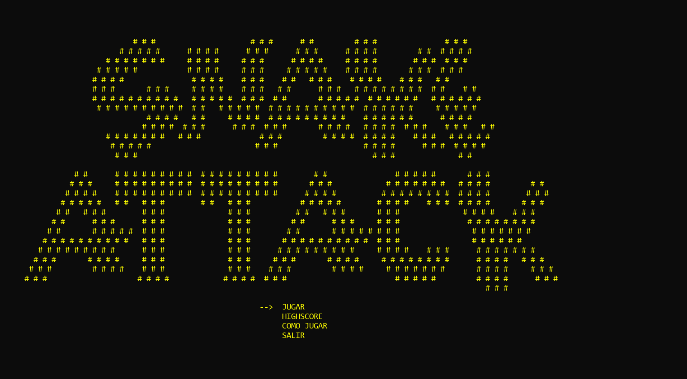

# SnakeAttack

Juego de supervivencia inspirado en Snake, desarrollado en **C para la consola de Windows**. Controla una serpiente, esquiva los proyectiles y los bordes del escenario, recoge potenciadores y trata de conseguir el mayor puntaje o vencer a un segundo jugador en el mismo equipo.

## Previsualización



*Título y menú principal del juego. Imagen renderizada a partir del contenido real del búfer de consola durante la ejecución.*

## ¿De qué consta el proyecto?

- **Un jugador:** supervivencia con puntaje y registro del nombre en los rankings.
- **Dos jugadores locales:** ambos comparten el teclado y compiten hasta que uno pierde sus vidas.
- **Modo clásico:** comienza en el nivel 1 y permite avanzar hasta el nivel 5.
- **Modo infinito:** permite elegir uno de los cinco niveles y permanecer en él.
- **Obstáculos y proyectiles:** evita los bordes, los misiles y la serpiente del otro jugador.
- **Potenciadores:** cambios de velocidad y color, controles invertidos, segmentos adicionales, vidas extra y aumento del puntaje. Su disponibilidad depende de la configuración del nivel y del número de jugadores.
- **Rankings:** muestra hasta diez puntuaciones por categoría, con una categoría para el modo clásico y cinco para los niveles del modo infinito.
- **Audio:** música de menú y partida, además de sonidos de colisión y cambio de nivel.

## Tecnologías utilizadas

| Tecnología | Uso en el proyecto |
| --- | --- |
| C y biblioteca estándar | Lógica del juego, memoria dinámica, archivos y procesamiento de datos. |
| API de Windows (`windows.h`) | Posicionamiento del cursor, lectura del teclado, colores y temporización. |
| `conio.h` | Entrada de teclado en los menús mediante `getch()`. |
| Windows Multimedia (`winmm`) | Reproducción de música y efectos WAV con `sndPlaySound`. |
| GCC / MinGW | Compilación del ejecutable para Windows y enlace con `winmm`. |
| Archivos CSV | Definición de escenarios y potenciadores, y persistencia de puntuaciones. |
| Listas y mapas ordenados propios | Gestión de segmentos, muros, proyectiles, potenciadores y rankings. |

La interfaz se dibuja con caracteres en la consola. El código depende de funciones específicas de Windows.

## Requisitos

- Windows.
- GCC para Windows, por ejemplo MinGW, disponible en la variable `PATH`.
- Una consola amplia: maximiza la ventana para ver el tablero y los indicadores completos.

## Compilar y ejecutar

Abre PowerShell en la carpeta raíz del proyecto y compila:

```powershell
gcc SnakeAttack.c list.c treemap.c menu.c juego.c functAux.c -o SnakeAttack.exe -lwinmm
```

Ejecuta desde esa misma carpeta:

```powershell
.\SnakeAttack.exe
```

Mantén las carpetas `archivosCSV` y `musica` junto al ejecutable: el programa busca sus recursos mediante rutas relativas al directorio de ejecución.

Al iniciar, confirma el aviso para maximizar la pantalla. En el menú puedes jugar, consultar los récords, leer las instrucciones o salir. Para una partida individual, introduce un nombre de hasta **14 caracteres sin espacios**, acorde con el almacenamiento reservado por el programa.

## Controles

| Acción | Jugador 1 | Jugador 2 |
| --- | --- | --- |
| Arriba | Flecha arriba o `I` | `W` |
| Abajo | Flecha abajo o `K` | `S` |
| Izquierda | Flecha izquierda o `J` | `A` |
| Derecha | Flecha derecha o `L` | `D` |

En los menús, utiliza las flechas arriba/abajo para seleccionar y `Enter` para confirmar. Una vez iniciado el movimiento, la serpiente avanza de forma continua hasta cambiar de dirección o colisionar.

## Estructura

```text
PROYECTO_SnakeAttack/
├── SnakeAttack.c               # Punto de entrada y ciclo entre menú y partidas
├── menu.c / menu.h             # Menús, instrucciones y consulta de rankings
├── juego.c / juego.h           # Jugadores, niveles, colisiones y potenciadores
├── functAux.c / functAux.h     # Consola, teclado y lectura de campos CSV
├── list.c / list.h             # Estructura de lista
├── treemap.c / treemap.h       # Mapa ordenado utilizado por los rankings
├── archivosCSV/
│   ├── PropiedadesJuego.csv    # Configuración de los cinco niveles
│   └── HighScores.csv          # Puntuaciones guardadas
├── musica/                    # Música y efectos de sonido en formato WAV
└── docs/images/               # Previsualización del juego
```

## Datos y mantenimiento

`archivosCSV/PropiedadesJuego.csv` define los jugadores, los límites del escenario y los potenciadores disponibles en cada nivel. Conserva su estructura al editarlo.

`archivosCSV/HighScores.csv` almacena las puntuaciones de las partidas individuales. Para reiniciar los récords, respalda el archivo y elimina todas las filas de datos, conservando la primera línea. Deja siempre un salto de línea al final del archivo, también después de la última fila cuando contenga puntuaciones.
